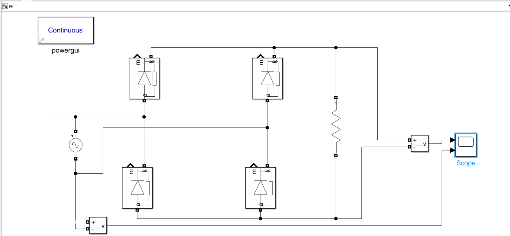
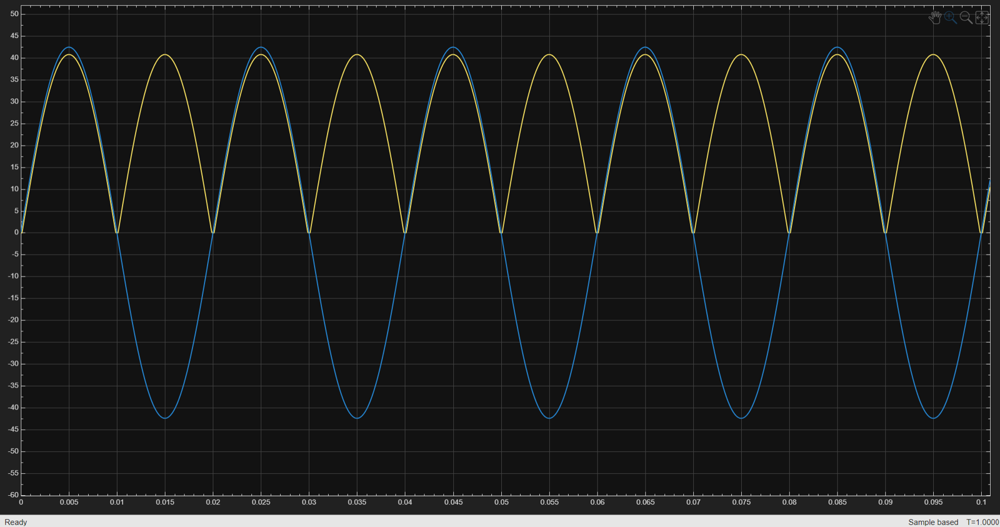

# Stage 1: Rectifier

Model: `PE.slx` (add your model file to this folder)

The first step of the project is a single-phase full-wave diode bridge rectifier feeding a resistive load. It checks the supply and shows what the converter will have to work with.

## Circuit
- AC voltage source, 50 Hz, peak `30*sqrt(2)` V (30 V rms).
- Four diodes in a bridge.
- Resistor as load.
- One voltage measurement across the load (rectified voltage) and one across the source.
- Both signals go to one scope.
- powergui: **Continuous**.

## Output

- **Blue:** source voltage, a sine with a peak of about 42.4 V (30 V rms) and a period of 20 ms.
- **Yellow:** rectified voltage. Both half cycles become positive, so the ripple frequency is **100 Hz** (period 10 ms).
- The rectified peak is about 40.8 V, roughly 1.6 V below the source peak. That is the voltage lost in the two diodes that conduct at any time.
- The rectified voltage falls to 0 V every half cycle.

## Why this matters for the next stage
The rectified voltage never goes above about 41 V, and the target output is 48 V, so the next stage must be a **boost** (step-up) converter. It also drops to zero twice per cycle, which is why the later control stages must handle the zero crossings carefully.

## Parameters

| Parameter | Value |
|---|---|
| Source | 50 Hz, `30*sqrt(2)` V peak |
| Load resistor | _fill in_ |
| Diode forward voltage / on-resistance | _fill in_ |
| Solver | powergui Continuous |

[Next: Stage 2, open-loop boost converter](../2.%20ACDC%20Boost%20Converter/README.md)
