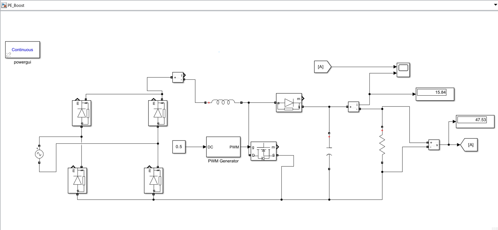
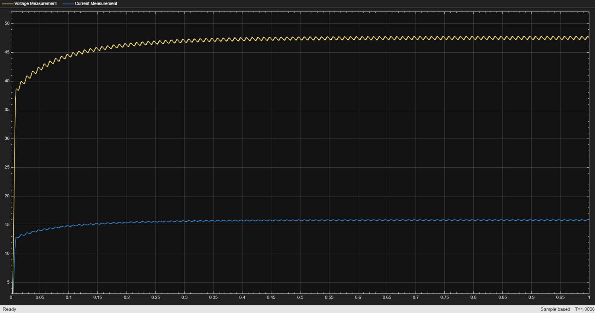

# Stage 2: AC-DC boost converter (open loop)

Model: `PE_Boost.slx` (add your model file to this folder)

A boost converter is placed behind the diode bridge. The duty cycle is a **constant 0.5**, so there is no feedback yet.

## Circuit
- AC source, diode bridge (as in stage 1), **no capacitor after the bridge**.
- Current sensor, inductor, MOSFET to ground, diode, output capacitor, resistive load.
- A **PWM Generator** with a constant input of 0.5 drives the MOSFET gate.
- Voltage sensor across the load (`[A]`), current sensor into the load, display blocks for the final voltage and current, and a scope.
- powergui: **Continuous**.

## Output

Yellow is the output voltage and blue is the load current.

- Final values from the display blocks: **47.53 V** and **15.84 A**, which is close to the 48 V / 16 A target.
- The output rises quickly to about 38 V, then climbs slowly over roughly 0.4 s while the output capacitor charges.
- A 100 Hz ripple is visible on both signals. It comes from the rectified input power pulsating at twice the line frequency.

## What this stage shows
- The boost converter can reach the target region from a rectified 30 V rms supply.
- The result is **not regulated**. The output depends on the duty cycle, the load and the supply, so a change in any of them moves the voltage. A feedback loop is needed to hold 48 V.

## Parameters

| Parameter | Value |
|---|---|
| Source | 50 Hz, `30*sqrt(2)` V peak |
| Duty cycle | 0.5 (constant) |
| Switching frequency | _20 kHz_ |
| Inductor | _1 mH_ |
| Output capacitor | _120 mF_ |
| Load | about 3 ohm |
| Solver | powergui Continuous |

[Previous: Stage 1](../1.%20Rectifier/README.md) | [Next: Stage 3, cascaded PI control](../3.%20Cascaded%20PI%20Control%20with%20Inner%20and%20Outer%20Loop/README.md)
