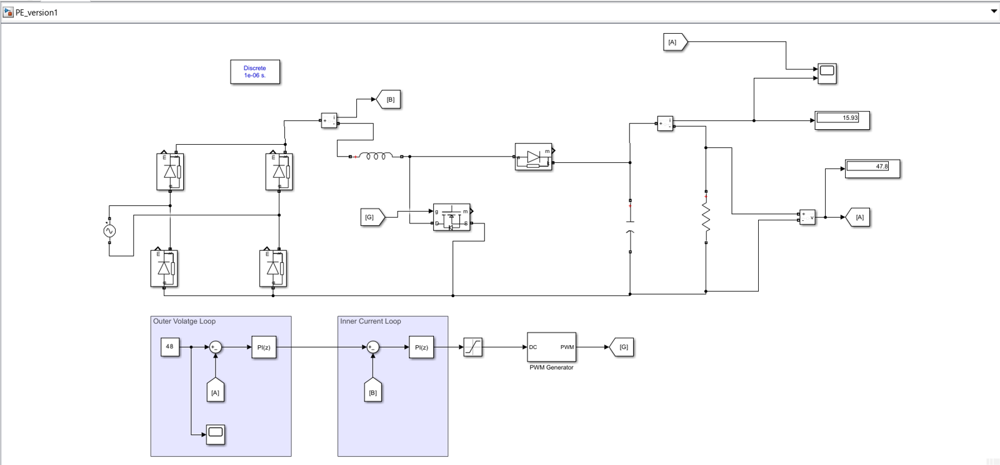
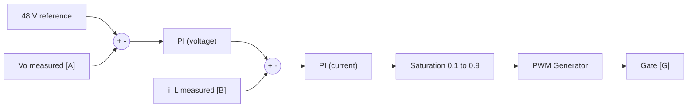
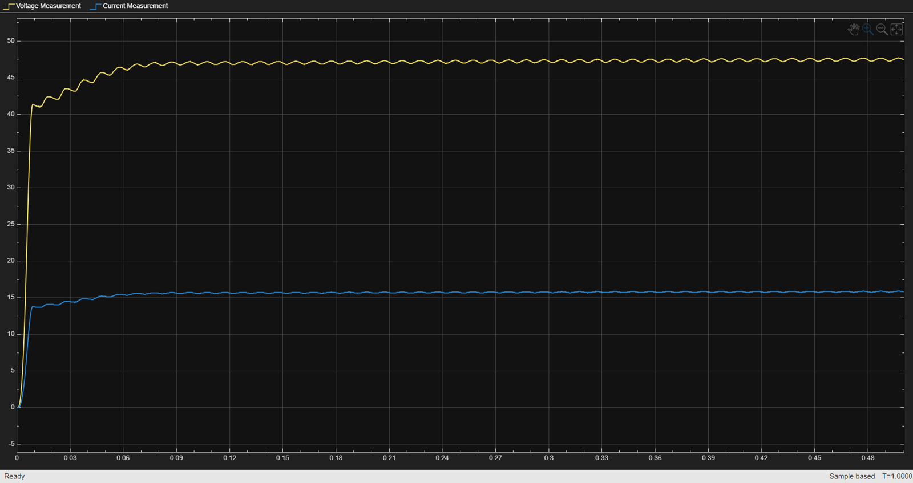

# Stage 3: Cascaded PI control (outer voltage loop and inner current loop)

Model: `PE_version1.slx` (add your model file to this folder)

Feedback is added to the stage 2 converter. An outer PI loop regulates the output voltage, and an inner PI loop regulates the inductor current and sets the duty cycle.

## Signal tags
| Tag | Signal |
|---|---|
| `[A]` | Output voltage (measured across the load) |
| `[B]` | Inductor current (current sensor after the rectifier) |
| `[G]` | Gate signal from the PWM Generator |

## Control chain
1. `48 V - [A]` gives the voltage error.
2. **PI (voltage)**: its output is the **inductor current reference**.
3. `reference - [B]` gives the current error.
4. **PI (current)** output goes to a **Saturation** block (duty cycle limits).
5. **PWM Generator** takes the saturated value as the duty cycle (`DC`) and creates the gate pulses `[G]`.

### Why the voltage PI output is the current reference
The output voltage can only be changed through the current charging the output capacitor (`C dVo/dt = i_diode - i_load`). So the voltage controller answers "how much inductor current do I need?", and the current controller answers "what duty cycle gives that current?". The outer loop is slow and the inner loop is fast, so the two can be tuned separately. See [`docs/theory.md`](../docs/theory.md).

## Output

Yellow is the output voltage and blue is the load current.

- Final values from the display blocks: **47.8 V** and **15.93 A**.
- The output reaches about 41 V almost immediately and about 47 V by roughly 0.1 s. A small steady-state error and the 100 Hz ripple remain.

## Settings

| Block | Setting |
|---|---|
| powergui | Discrete, sample time `1e-6` |
| PWM Generator | Carrier counter Up, timer period `5e-5` s, phase delay 0, sample time `1e-6` s |
| Saturation | 0.1 to 0.9 (duty cycle limits) |
| Voltage PI | Kp = 20, Ki = 40 |
| Current PI | Kp = 0.5, Ki = 50 |
| Voltage PI output limit | not recorded |
| Inductor | 1 mH |
| Output capacitor | 120 mF |
| Source | 50 Hz, `30*sqrt(2)` V peak |

## Notes
- The voltage PI output is used directly as the current reference, with no multiplication by the rectified voltage. This stage regulates the output but does not force the input current to follow the supply voltage shape. Stage 4 adds that.
- The solver is discrete, so all controller blocks must be discrete (`PI(z)`).
- The PWM period and sample time must be integer multiples of the fixed step.

[Previous: Stage 2](../2.%20ACDC%20Boost%20Converter/README.md) | [Next: Stage 4, S-R flip-flop](../4.%20SR%20FlipFlop%20Control/README.md)
