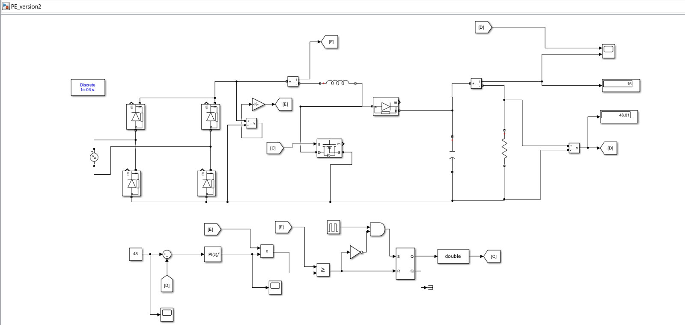
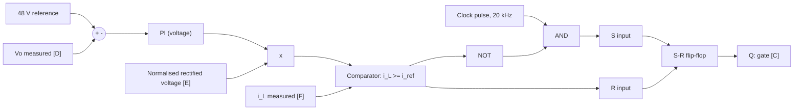
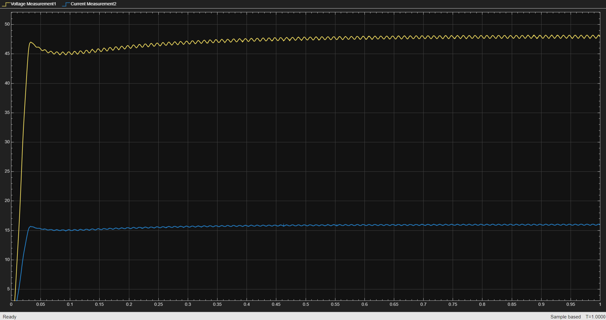

# Stage 4: S-R flip-flop control (peak current mode)

Model: `PE_version2.slx` (add your model file to this folder)

The current PI and the PWM Generator of stage 3 are replaced by a comparator and an S-R flip-flop. The duty cycle is no longer computed. It results from the moment the inductor current reaches the reference.

## Signal tags
| Tag | Signal |
|---|---|
| `[D]` | Output voltage (measured across the load) |
| `[E]` | Rectified voltage, normalised so that its peak is 1 |
| `[F]` | Inductor current (current sensor after the rectifier) |
| `[C]` | Gate signal (flip-flop output, converted to double) |

## Control chain
1. `48 V - [D]` gives the voltage error.
2. **PI(z) (voltage)** output = amplitude of the input current reference.
3. **Product:** PI output x `[E]` = instantaneous current reference `i_ref`.
4. **Relational Operator** `>=`: input 1 = `[F]` (i_L), input 2 = `i_ref`.
5. **R input** = comparator output.
6. **S input** = clock pulse AND NOT(comparator output).
7. **S-R flip-flop** `Q` -> **Data Type Conversion (double)** -> `[C]` -> MOSFET gate. `!Q` is terminated.

### How it works
1. Each clock pulse **sets** the flip-flop and the MOSFET turns on, so the inductor current rises.
2. When the inductor current reaches the reference, the comparator **resets** the flip-flop and the MOSFET turns off.
3. The flip-flop is a latch. After a reset, noise on the comparator cannot turn the MOSFET on again in the same cycle.
4. Near the zero crossings of the supply, the reference is close to zero and the comparator is already high when the clock arrives. The AND with NOT(comparator) makes **reset win**, so no narrow glitch pulses appear.
5. Multiplying the voltage PI output by `[E]` gives a current reference with the shape of the rectified supply voltage.

## Output

Yellow is the output voltage and blue is the load current.

- Final values from the display blocks: **48.01 V** and **16 A**.
- The output reaches about 47 V within about 0.03 s, then converges to 48 V over a few tenths of a second, because the voltage loop is slow by design.
- The 100 Hz ripple comes from the pulsating input power.

## Settings

| Block | Setting |
|---|---|
| powergui | Discrete, sample time `1e-6` |
| Model solver | Fixed-step, discrete (no continuous states), step `1e-6` |
| Source | 50 Hz, `30*sqrt(2)` V peak |
| Gain `-K-` | `1/(30*sqrt(2))` so that `[E]` peaks at 1 |
| Voltage PI(z) | Kp = 10, Ki = 60, output limits lower 0 and upper 45, anti-windup (clamping) |
| Product | 2 inputs |
| Relational Operator | `>=` |
| Pulse Generator | Period `5e-5` s, width an integer number of steps (recommended 2 steps = 2 us; confirm your value) |
| Logical Operators | NOT (1 input), AND (2 inputs) |
| S-R Flip-Flop | Initial condition 0 |
| Data Type Conversion | Output data type `double` |
| Terminator | On `!Q` |
| Inductor | 1 mH |
| Output capacitor | 120 mF |

## Known limitations
- Slope compensation is not yet added. The duty cycle exceeds 50 % near the zero crossings, where fixed-frequency peak current mode can become unstable.
- Peak current is controlled, not average current, so the average is slightly lower than the reference. The voltage loop compensates.
- Input power factor and THD have not been measured yet.

[Previous: Stage 3](../3.%20Cascaded%20PI%20Control%20with%20Inner%20and%20Outer%20Loop/README.md)
